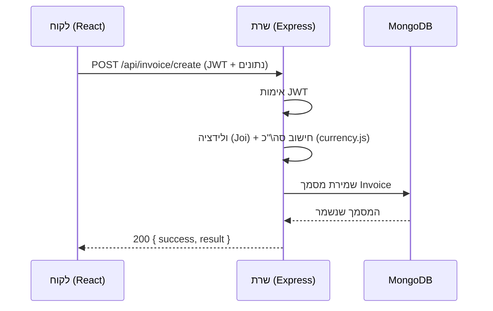
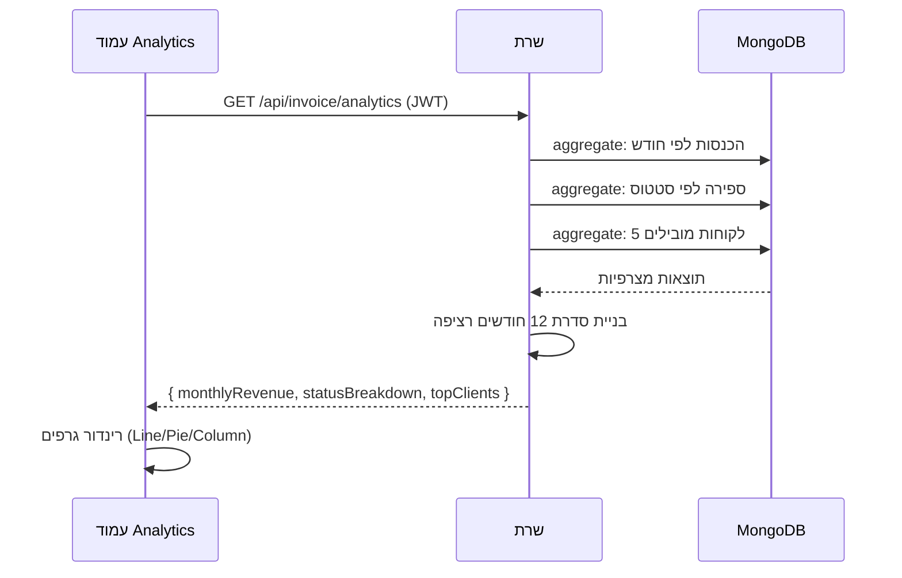
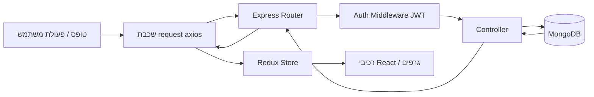

<div align="center">

# ‏FluxCRM — מערכת CRM לניהול לקוחות, חשבוניות ותשלומים לנותני שירות

### ספר פרויקט גמר — הנדסת תוכנה

**‏[[שם המכללה — למילוי]]**

*(כאן יש למקם: לוגו המכללה + לוגו מה"ט)*

מגמת הלימוד: **הנדסת תוכנה** | מסלול: **הנדסאים**

---

**מגישים:**

| שם הסטודנט/ית | תעודת זהות | תחום אחריות |
|---|---|---|
| עומר ניסים מסה | ‏[[ת"ז — למילוי]] | Backend |
| מנחם מענדל לאופר | ‏[[ת"ז — למילוי]] | Backend |
| רם רחמים משיח | ‏[[ת"ז — למילוי]] | Frontend |
| דוד שטיינברג | ‏[[ת"ז — למילוי]] | Frontend |

**מנחה אישי:** ‏[[שם המנחה — למילוי]]

**תאריך מסירה:** ‏[[תאריך — למילוי]]

**מאגר קוד (Git):** https://github.com/avivSolomon/fluxCrm

</div>

<div style="page-break-after: always;"></div>

## הצהרת הסטודנטים

אנו החתומים מטה מצהירים בזאת כי פרויקט הגמר "FluxCRM" נעשה על ידינו, וכי אנו מבינים את כל מרכיביו.
הפרויקט מבוסס על מערכת קוד-פתוח (IDURAR ERP/CRM) המופצת ברישיון **AGPL-3.0**; על בסיס זה ביצענו אבחון, תיקוני באגים, קשיחות אבטחה, מיתוג, וכן **פיתוח עצמאי של תוספות מקוריות**: דשבורד אנליטי, מערכת רב-לשונית (עברית/אנגלית) עם תמיכת RTL, ומערך בדיקות אוטומטיות. הבסיס הפתוח ותרומתנו מתועדים במפורש בספר זה ובהיסטוריית ה-Git.

| שם | חתימה | תאריך |
|---|---|---|
| עומר ניסים מסה | | |
| מנחם מענדל לאופר | | |
| רם רחמים משיח | | |
| דוד שטיינברג | | |

<div style="page-break-after: always;"></div>

## תוכן עניינים

1. תיאור ורקע כללי
2. מטרות המערכת
3. סקירת מצב קיים בשוק
4. חידוש ושיפור — תרומת הפרויקט
5. דרישות מערכת ופונקציונליות
6. בעיות שהתעוררו במהלך הפיתוח ופתרונן
7. הפתרון הטכנולוגי הנבחר
8. מבני נתונים וארגון קבצים
9. תרשימי מערכת מרכזיים
10. המרכיב האלגוריתמי־אנליטי
11. אבטחת מידע
12. משאבים נדרשים לפרויקט
13. תוכנית עבודה ושלבי מימוש
14. תכנון הבדיקות
15. בקרת גרסאות

<div style="page-break-after: always;"></div>

---

## 1. תיאור ורקע כללי

**FluxCRM** היא מערכת ווב לניהול קשרי לקוחות (CRM) ולניהול פיננסי בסיסי (חשבוניות ותשלומים), המיועדת בעיקר ל**נותני שירות ועסקים קטנים ובינוניים**: פרילנסרים, משרדי ייעוץ, קליניקות, נותני שירותי IT וכדומה.

המערכת מאפשרת לנהל במקום אחד את מאגר הלקוחות, להפיק חשבוniות, לעקוב אחר סטטוס תשלומים, ולצפות בתמונת מצב עסקית באמצעות דשבורד אנליטי. המערכת נבנתה כאפליקציית **Single Page Application** מבוססת דפדפן, עם הפרדה מלאה בין שרת (API) ללקוח (UI).

הפרויקט מבוסס על בסיס הקוד הפתוח **IDURAR ERP/CRM** (רישיון AGPL-3.0), שעליו ביצענו לימוד מעמיק, אבחון, תיקון תקלות, קשיחות אבטחה, ומיתוג מחדש. על גבי בסיס זה פיתחנו תוספות מקוריות משלנו (ראו פרק 4). גישה זו — לימוד מערכת קיימת ברמת קוד המקור והרחבתה — מדמה תרחיש נפוץ בתעשייה שבו מהנדס נכנס למערכת קיימת, לומד אותה, מתחזק ומרחיב אותה.

## 2. מטרות המערכת

מטרת-העל: לספק לנותן השירות כלי פשוט, מהיר ומקומי (גם בעברית) לניהול הלקוחות והכספים, ללא המורכבות והעלות של מערכות ERP גדולות.

מטרות מפורטות:

- **ניהול לקוחות** — יצירה, עריכה, חיפוש ומחיקה (רכה) של כרטיסי לקוח.
- **ניהול חשבוניות** — הפקת חשבונית מרובת פריטים, חישוב סכומי ביניים/מס/סה"כ, מעקב סטטוס ותפוגה, ייצוא ל-PDF.
- **ניהול תשלומים** — רישום תשלומים כנגד חשבוניות ומעקב יתרות (שולם/לא שולם/חלקי).
- **תמונת מצב עסקית** — דשבורד אנליטי עם גרפים (הכנסות לאורך זמן, פילוח סטטוסים, לקוחות מובילים).
- **נגישות שפה** — ממשק דו-לשוני עברית/אנגלית עם התאמת כיווניות (RTL).
- **אבטחה** — הזדהות מבוססת JWT, סיסמאות מוצפנות, בקרת גישה.

## 3. סקירת מצב קיים בשוק

שוק ה-CRM רווי בפתרונות, אך רובם אינם אופטימליים עבור נותן שירות קטן בישראל:

| מערכת | חוזקות | חסרונות עבור קהל היעד |
|---|---|---|
| Salesforce | עוצמתי, מודולרי | יקר מאוד, מורכב, overkill לעסק קטן |
| Zoho CRM | עשיר בפיצ'רים | עקומת למידה, תמחור מדורג, עברית/RTL חלקית |
| Monday.com | חווית משתמש טובה | לא ייעודי לחשבוניות/CRM קלאסי, מנוי חודשי |
| מערכות ישראליות (Powerlink וכו') | תמיכה בעברית | עלות גבוהה, סגור, קשה להתאמה |

**הבעיות המרכזיות בשוק עבור קהל היעד:**
1. **עלות** — רישוי חודשי מצטבר, לא כדאי לעסק קטן.
2. **מורכבות** — פיצ'רים רבים שאינם רלוונטיים לנותן שירות.
3. **תמיכת עברית/RTL** — לעיתים חלקית או לא מלאה.
4. **סגירוּת** — קושי בהתאמה אישית; אין גישה לקוד.

FluxCRM, בהיותה מבוססת קוד פתוח, ניתנת לאירוח עצמי (self-hosting) ללא עלות רישוי, ופתוחה להתאמות.

## 4. חידוש ושיפור — תרומת הפרויקט

זהו לב הפרויקט: מה **אנחנו** תרמנו מעבר לבסיס הקיים. התרומות מתחלקות לשלוש תוספות מקוריות ולעבודת קשיחות ותחזוקה.

### 4.1 תוספות מקוריות (פיתוח עצמאי)

1. **דשבורד אנליטי** — נקודת קצה (endpoint) חדשה בשרת המבצעת אגרגציות ב-MongoDB, ועמוד ייעודי בצד הלקוח עם שלושה גרפים (קו/עוגה/עמודות). ראו פרק 10.
2. **מערכת רב-לשונית עברית/אנגלית עם RTL** — הבסיס תמך למעשה רק באנגלית (מנגנון התרגום היה מנוטרל). הפעלנו מחדש את מנגנון התרגום, בנינו מילון עברי (~200 מונחים), הוספנו בורר שפה, ותמיכת כיווניות RTL אוטומטית.
3. **מערך בדיקות אוטומטיות** — לבסיס לא היו בדיקות כלל. בנינו מערך בדיקות יחידה ובדיקות אינטגרציה (Jest + supertest). ראו פרק 14.

### 4.2 קשיחות, תיקונים ותחזוקה

- **תיקון 3 באגים** שמנעו הרצה תקינה (ראו פרק 6).
- **קשיחות אבטחה** — החלפת מפתח JWT מוגדר-מראש (placeholder) במפתח אקראי חזק, הוצאת קובץ הסודות (`.env`) ממעקב הגרסאות, תיקון חבילה פגיעה (multer, CVE-2022-24434).
- **מיתוג מלא** ל-FluxCRM והסרת קישורים מסחריים/פרסומיים של הבסיס.
- **ניקוי קוד מת** (מודול דשבורד לא בשימוש, imports וקוד מוער).

## 5. דרישות מערכת ופונקציונליות

### 5.1 דרישות מערכת (לא-פונקציונליות)

- **סביבת הרצה:** שרת Node.js (v20+), מסד נתונים MongoDB, דפדפן מודרני בצד הלקוח.
- **פריסה (Deployment):** אפשרות אירוח מקומי או ענן; בפיתוח — שרת מקומי + MongoDB מקומי.
- **ביצועים:** תגובת API טיפוסית < 200ms לפעולות CRUD; אגרגציית האנליטיקה מבוצעת במסד (pipeline) ולא בקוד היישום, לצמצום העברת נתונים.
- **שרידוּת:** מצב "מחיקה רכה" (`removed: true`) במקום מחיקה פיזית, המאפשר שחזור.
- **התמודדות עם עומסים:** דחיסת תגובות (compression), הגבלת קצב בקשות (rate-limit) על נקודות רגישות.
- **אבטחה:** הזדהות מחייבת לכל נקודות ה-API של היישום; סיסמאות מוצפנות (bcrypt).

### 5.2 דרישות פונקציונליות (סיפורי משתמש)

| # | כמשתמש אני רוצה... | כדי ש... |
|---|---|---|
| F1 | להתחבר עם דוא"ל וסיסמה | רק אני אגש לנתונים שלי |
| F2 | ליצור/לערוך/למחוק לקוח | לנהל את מאגר הלקוחות |
| F3 | לחפש לקוח לפי שם | למצוא מידע במהירות |
| F4 | להפיק חשבונית מרובת פריטים | לחייב את הלקוח |
| F5 | לראות חישוב אוטומטי של סה"כ ומע"מ | להימנע מטעויות |
| F6 | לרשום תשלום כנגד חשבונית | לעקוב אחרי גבייה |
| F7 | לראות סטטוס חשבונית (שולם/לא/חלקי) | לדעת מי חייב לי |
| F8 | לייצא חשבונית ל-PDF | לשלוח ללקוח |
| F9 | לצפות בדשבורד אנליטי | להבין את מצב העסק |
| F10 | להחליף שפה לעברית/אנגלית | לעבוד בשפה הנוחה לי |

## 6. בעיות שהתעוררו במהלך הפיתוח ופתרונן

פרק זה מתעד בעיות אמיתיות שנתקלנו בהן והפתרונות שיישמנו — כפועל יוצא של דרישות המשתמש והסביבה.

| # | הבעיה | סוג | הפתרון |
|---|---|---|---|
| P1 | סקריפט האתחול (`setup.js`) קרס עם `MODULE_NOT_FOUND` על מודלים חסרים (`PaymentMode`, `Taxes`) שהוסרו מהבסיס | טכנולוגית | הפכנו את הזריעה לעמידה: זריעה מותנית בקיום קובץ המודל (`fs.existsSync`) |
| P2 | צד הלקוח קרס במסך לבן: `ReferenceError: Quote is not defined` — ראוטים ופריטי תפריט שהפנו למסכים שנמחקו | טכנולוגית | הסרנו את הראוטים ופריטי הניווט השבורים |
| P3 | Docker Desktop הקפיא את המחשב (7.8GB RAM בלבד) | תפעולית / עומס | מעבר מ-Docker ל-MongoDB מקומי כשירות Windows קליל |
| P4 | מפתח JWT היה placeholder קבוע — חור אבטחה | אבטחה | ייצור מפתח אקראי חזק; הוצאת `.env` ממעקב git |
| P5 | התנגשויות פריסה (layout) במעבר ל-RTL — CSS שמקבע ימין/שמאל | טכנולוגית / UI | קובץ `rtl.css` עם overrides ל-`[dir=rtl]`; עטיפת הגרפים ב-`dir="ltr"` |
| P6 | מנגנון התרגום היה מנוטרל (החזיר תמיד אנגלית) | טכנולוגית | הפעלה מחדש של חיפוש התרגום + מילון עברי |

**חלופות ארכיטקטוניות שנשקלו** (P3): התלבטנו בין (א) הגבלת זיכרון ל-Docker דרך `.wslconfig`, (ב) חשבון ענן MongoDB Atlas, (ג) התקנה מקומית. בחרנו בהתקנה מקומית כשירות — הפתרון הקל ביותר למשאבי המחשב, ללא תלות ברשת וללא עלות.

## 7. הפתרון הטכנולוגי הנבחר

### 7.1 טופולוגיית הפתרון (Deployment)

ארכיטקטורת **שלוש שכבות** (Three-Tier):

```
[ דפדפן / React SPA ]  ⇄  HTTP/REST (JSON)  ⇄  [ Node.js + Express API ]  ⇄  [ MongoDB ]
       שכבת תצוגה                                    שכבת לוגיקה                שכבת נתונים
     (פורט 3000)                                     (פורט 8888)               (פורט 27017)
```

- **שכבת תצוגה:** אפליקציית React הרצה בדפדפן, מתקשרת עם השרת ב-REST.
- **שכבת לוגיקה:** שרת Express החושף REST API, מטפל באימות, בוולידציה ובגישה למסד.
- **שכבת נתונים:** MongoDB (מסד מסמכים).

בפיתוח: כל השלוש רצות על מכונת המפתח (localhost). בפריסה: ניתן להפריד את השרת והמסד לענן.

### 7.2 טכנולוגיות ושפות פיתוח

| שכבה | טכנולוגיה | שפה |
|---|---|---|
| Frontend | React 18, Redux Toolkit, Ant Design, Vite, Ant Design Plots | JavaScript / JSX |
| Backend | Node.js 20, Express 4, Mongoose 8 | JavaScript |
| Database | MongoDB 8 | — |
| בדיקות | Jest, Supertest | JavaScript |
| ניהול גרסאות | Git, GitHub | — |

### 7.3 תיאור הארכיטקטורה

הפרויקט בנוי בגישת **Convention over Configuration**: השרת סורק דינמית את תיקיית המודלים ובונה אוטומטית בקרי CRUD גנריים (`createCRUDController`) ואת נתיבי ה-API לכל ישות (`/api/<entity>/create|read|update|delete|list|search`). לישויות מורכבות (חשבונית, תשלום) קיימים בקרים מותאמים המרחיבים את הגנרי (יצירה, שליחת מייל, סיכום, אנליטיקה).

### 7.4 חלוקה לתוכניות ומודולים

**Backend (`backend/src/`):**
- `models/` — סכמות Mongoose (coreModels, appModels)
- `controllers/` — לוגיקה עסקית (core, app, middlewares, pdf)
- `routes/` — הגדרת נתיבי ה-API
- `middlewares/` — אימות, הגדרות, העלאת קבצים
- `setup/` — סקריפטי אתחול וזריעת נתונים

**Frontend (`frontend/src/`):**
- `pages/` — עמודי היישום (Customer, Invoice, Payment, Analytics, Settings...)
- `modules/` — רכיבי-על (CrudModule, ErpPanelModule, AnalyticsModule...)
- `redux/` — ניהול מצב (auth, crud, settings...)
- `locale/` — תרגומים ומנגנון השפה
- `router/` — הגדרת ניתוב
- `request/` — שכבת התקשורת עם ה-API (axios)

**מסכים עיקריים:** התחברות, ניהול לקוחות, ניהול חשבוניות (רשימה/יצירה/צפייה/עריכה), ניהול תשלומים, **אנליטיקות**, הגדרות.

### 7.5 סביבת השרת

בפיתוח: שרת מקומי (Node) + MongoDB מקומי (שירות Windows). ניתן להעביר לפריסת ענן / שירות אירוח בעתיד.

### 7.6 ממשק המשתמש (GUI)

מבוסס **Ant Design (AntD)** — ספריית רכיבים עשירה (טפסים, טבלאות, מודלים). הממשק רספונסיבי ותומך בהחלפת כיווניות (LTR/RTL) דרך `ConfigProvider`.

### 7.7 ממשקים (API)

**REST API** מבוסס JSON. כל נקודות ה-API של היישום מוגנות ב-JWT (למעט התחברות). דוגמאות:
- `POST /api/login` — הזדהות
- `GET /api/client/list` — רשימת לקוחות
- `POST /api/invoice/create` — יצירת חשבונית
- `GET /api/invoice/analytics` — נתוני אנליטיקה (תוספת מקורית)

### 7.8 שימוש בחבילות תוכנה עיקריות

`express`, `mongoose`, `jsonwebtoken`, `bcryptjs`, `joi` (ולידציה), `express-rate-limit`, `multer`/`express-fileupload` (העלאות), `pug`+`html-pdf` (הפקת PDF), `moment`, `currency.js` (חישובי כסף מדויקים), `react`, `antd`, `@ant-design/plots`, `@reduxjs/toolkit`, `axios`, `vite`.

## 8. מבני נתונים וארגון קבצים

### 8.1 שיטת האחסון

מסד נתונים **MongoDB** (מסמכי JSON). היחסים בין ישויות ממומשים באמצעות `ObjectId` + `ref` של Mongoose, עם טעינה אוטומטית (`autopopulate`).

### 8.2 האוספים (Collections) והשדות המרכזיים

| Collection | תיאור | שדות מרכזיים |
|---|---|---|
| **Admin** | משתמשי מערכת | email, name, surname, role, enabled |
| **AdminPassword** | סיסמאות מוצפנות | user(ref), password(hash), salt, loggedSessions[] |
| **Setting** | הגדרות מערכת | settingCategory, settingKey, settingValue |
| **Client** | לקוחות | name, email, phone, country, address, createdBy(ref) |
| **Invoice** | חשבוניות | number, date, client(ref), items[], subTotal, taxTotal, total, status, paymentStatus, payment[] |
| **Payment** | תשלומים | number, client(ref), invoice(ref), date, amount, currency |
| **Upload** | קבצים שהועלו | — |

**מבנה תת-מסמך `items` בחשבונית:** `{ itemName, description, quantity, price, total }`.

### 8.3 מנגנוני התאוששות ושלמות נתונים

- **מחיקה רכה** (`removed`) — אין מחיקה פיזית; רשומות מסומנות ומסוננות, מה שמאפשר שחזור ומונע אובדן היסטוריה.
- **ולידציה** — סכמות Mongoose + Joi אוכפות טיפוסים ושדות חובה לפני כתיבה.
- **חישובי כסף** — באמצעות `currency.js` להימנעות משגיאות נקודה צפה.

## 9. תרשימי מערכת מרכזיים

> התרשימים כתובים בתחביר **Mermaid**. ניתן לרנדר אותם ולהמיר לתמונה (למשל ב-mermaid.live) ולהטמיע ב-Word.

### 9.1 תרשים תרחישי שימוש (Use Case)

```mermaid
graph TD
    U([משתמש / מנהל])
    U --> UC1[התחברות]
    U --> UC2[ניהול לקוחות]
    U --> UC3[ניהול חשבוניות]
    U --> UC4[רישום תשלומים]
    U --> UC5[צפייה בדשבורד אנליטי]
    U --> UC6[הפקת PDF]
    U --> UC7[החלפת שפה]
    UC3 --> UC3a[חישוב סה\"כ ומע\"מ]
    UC4 --> UC4a[עדכון סטטוס תשלום]
```

### 9.2 תרשים רצף (Sequence) — יצירת חשבונית



### 9.3 תרשים רצף (Sequence) — האנליטיקה (התוספת המקורית)



### 9.4 תרשים זרימת נתונים (Data Flow)



## 10. המרכיב האלגוריתמי־אנליטי

התוספת המקורית המרכזית. נקודת הקצה `GET /api/invoice/analytics` מבצעת שלוש אגרגציות ב-MongoDB ומחזירה מבנה אחד לצריכת הדשבורד.

**איזו בעיה נפתרת?** נותן שירות זקוק לתמונת מצב מהירה: כמה הרווחתי כל חודש? כמה חשבוניות בכל סטטוס? מי הלקוחות הכי משתלמים? הבסיס לא סיפק זאת (הדשבורד המקורי הציג רק כרטיסי סיכום, ללא גרפים אמיתיים).

**כיצד נפתר?** באמצעות **Aggregation Pipeline** של MongoDB — החישוב מתבצע במסד ולא בקוד היישום, ליעילות:

1. **הכנסות לפי חודש (12 חודשים):** סינון לפי טווח תאריכים → קיבוץ (`$group`) לפי שנה+חודש עם `$sum` על ה-`total` → מיון. לאחר מכן, בקוד, בונים **סדרה רציפה של 12 חודשים** כך שחודשים ללא חשבוניות מוצגים כאפס (חשוב לגרף הקו).
2. **פילוח לפי סטטוס:** `$group` לפי `status` עם ספירה — עבור גרף העוגה.
3. **5 לקוחות מובילים:** `$group` לפי לקוח עם `$sum`, מיון יורד, `$limit: 5`, ו-`$lookup` לשליפת שם הלקוח — עבור גרף העמודות.

**קטע קוד מייצג (השרת):**

```javascript
const startDate = moment().subtract(11, 'months').startOf('month').toDate();
const monthlyRaw = await Model.aggregate([
  { $match: { removed: false, date: { $gte: startDate } } },
  { $group: {
      _id: { year: { $year: '$date' }, month: { $month: '$date' } },
      total: { $sum: '$total' }, count: { $sum: 1 },
  } },
  { $sort: { '_id.year': 1, '_id.month': 1 } },
]);
// בניית סדרת 12 חודשים רציפה (חודשים ריקים = 0)
```

בצד הלקוח, עמוד `AnalyticsModule` צורך את הנתונים ומרנדר שלושה גרפים (Line/Pie/Column) בעזרת `@ant-design/plots`, כולל תרגום שמות הסטטוסים לעברית ועטיפה ב-`dir="ltr"` לרינדור תקין תחת RTL.

## 11. אבטחת מידע

| אזור הדורש אבטחה | האיום | המענה במערכת |
|---|---|---|
| חשבונות משתמש | חשיפת סיסמאות | הצפנת סיסמאות ב-**bcrypt** עם **salt** ייחודי; הסיסמה עצמה לעולם אינה נשמרת |
| הזדהות / סשן | גישה לא מורשית ל-API | **JWT** חתום; כל נקודות ה-API של היישום מאחורי middleware אימות |
| ניתוק / גניבת token | שימוש ב-token לאחר התנתקות | רשימת **loggedSessions** — token תקף רק אם הוא ברשימת הסשנים הפע ילים |
| מפתחות וסודות | דליפת סוד מהקוד | סוד ה-JWT הוחלף במפתח אקראי חזק; קובץ `.env` **הוצא ממעקב git** + `.env.example` כתבנית |
| מסד הנתונים | הזרקת שאילתות (injection) | ולידציה (Joi/Mongoose) + סינון אופרטורים זדוניים בפרמטרי סינון |
| שרת / API | הצפת בקשות (DoS) | **express-rate-limit** על נקודות רגישות; דחיסת תגובות |
| חבילות צד ג' | פגיעוּת ידועה | שדרוג `multer` ל-`1.4.5-lts.2` (תיקון CVE-2022-24434) |

**דוגמאות תרחיש → מענה:**
- *תרחיש:* תוקף מנסה לגשת ל-`/api/client/list` ללא token. *מענה:* השרת מחזיר `401 Unauthorized`.
- *תרחיש:* משתמש התנתק, אך תוקף שמר את ה-token. *מענה:* ה-token אינו ב-`loggedSessions` → נדחה.
- *תרחיש:* קלט משתמש מכיל אופרטור MongoDB (`$gt`) בפרמטר סינון. *מענה:* הקלט נדחה/מנוקה לפני הגעה למסד.

## 12. משאבים נדרשים לפרויקט

### 12.1 שעות וחלוקת עבודה בין חברי הצוות

הצוות (4 סטודנטים) חולק לשני זוגות לפי שכבות המערכת:

| חבר צוות | תחום | תרומות עיקריות |
|---|---|---|
| עומר ניסים מסה | Backend | נקודת האנליטיקה (aggregation), אימות ואבטחה, תיקוני setup, מערך הבדיקות |
| מנחם מענדל לאופר | Backend | מודלים ובקרי CRUD, נתיבי API, זריעת נתונים, בדיקות אינטגרציה |
| רם רחמים משיח | Frontend | עמוד האנליטיקה והגרפים, שכבת request, ניתוב |
| דוד שטיינברג | Frontend | מערכת הרב-לשוניות (i18n), תיקוני RTL, מיתוג ותצוגה |

*(היקף שעות מוערך: ~300 שעות לכל הנדסאי, בהתאם לנוהל. פירוט לפי שלבים — פרק 13.)*

### 12.2 ציוד נדרש

מחשב פיתוח (Windows), חיבור אינטרנט, דפדפן מודרני.

### 12.3 תוכנות נדרשות

Node.js 20, MongoDB Community Server, Git, עורך קוד (VS Code), Postman (לבדיקת API).

### 12.4 ידע חדש שנדרש ללמוד

MERN Stack, אגרגציות MongoDB, JWT ואבטחת ווב, בדיקות אוטומטיות (Jest/Supertest), i18n ו-RTL, ניהול גרסאות ב-Git, לימוד וניווט בבסיס קוד קיים גדול.

### 12.5 ספרות ומקורות מידע

תיעוד רשמי: Node.js, Express, MongoDB/Mongoose, React, Ant Design, Redux Toolkit, Jest; פרויקט הבסיס IDURAR (GitHub); מאמרי OWASP לאבטחת ווב.

## 13. תוכנית עבודה ושלבי מימוש

| שלב | תיאור | תוצר |
|---|---|---|
| 1 | אבחון בסיס הקוד, הבנת הארכיטקטורה | מפת מערכת, רשימת בעיות |
| 2 | הקמת סביבת פיתוח (Node, MongoDB), הרצה | מערכת רצה מקומית |
| 3 | תיקון באגים חוסמים (setup, routes) + קשיחות אבטחה | מערכת יציבה ומאובטחת |
| 4 | מיתוג ל-FluxCRM + חיבור לניהול גרסאות משלנו | repo פרטי ב-GitHub |
| 5 | פיתוח דשבורד אנליטי (שרת + לקוח) | תוספת מקורית #1 |
| 6 | מערכת רב-לשונית עברית/אנגלית + RTL | תוספת מקורית #2 |
| 7 | מערך בדיקות אוטומטיות | תוספת מקורית #3 |
| 8 | ניקוי קוד ושדרוג חבילות | בסיס קוד נקי |
| 9 | כתיבת ספר הפרויקט והכנה להגנה | ספר + מצגת |

## 14. תכנון הבדיקות

מערך הבדיקות מומש ב-**Jest + Supertest** ורץ מול מסד נתונים בדיקות מבודד (`fluxcrm_test`). הרצה: `npm test`. סה"כ **11 בדיקות ב-4 חבילות — כולן עוברות**.

### 14.1 בדיקות תהליכיות ברמת משתמש (Full Flow)

| # | תרחיש | קלט | תוצאה מצופה |
|---|---|---|---|
| T1 | התחברות תקינה | admin@admin.com / admin123 | `200`, מוחזר token |
| T2 | התחברות עם סיסמה שגויה | סיסמה שגויה | `success:false`, אין token |
| T3 | התחברות עם דוא"ל לא קיים | דוא"ל לא קיים | `success:false` |
| T4 | יצירת לקוח ואיתורו ברשימה | שם לקוח + token | הלקוח מופיע ברשימה |
| T5 | גישה ל-API ללא token | ללא Authorization | `401 Unauthorized` |
| T6 | קבלת נתוני אנליטיקה | token + נתוני זרע | סדרת 12 חודשים + פילוחים תקינים |
| T7 | גישה לאנליטיקה ללא token | ללא token | `401` |

### 14.2 בדיקות יחידה (Unit) למודולים מרכזיים

| # | מודול | בדיקה |
|---|---|---|
| U1 | `calculate.add` | ‏0.1 + 0.2 === 0.3 (דיוק מטבע) |
| U2 | `calculate.sub` | חיסור תקין |
| U3 | `calculate.multiply` | חישוב סה"כ שורה (כמות × מחיר) |
| U4 | `calculate.divide` | חלוקה תקינה |

## 15. בקרת גרסאות (Version Control)

הפרויקט מנוהל ב-**Git** ומאוחסן ב-**GitHub** (repo פרטי: `avivSolomon/fluxCrm`, ענף `main`). מאגר הבסיס נותק (הוגדר כ-`upstream-idurar` עם דחיפה מנוטרלת) כדי למנוע דחיפה בטעות אליו.

**היסטוריית ה-commits המרכזיים של תרומתנו:**

| Commit | תיאור |
|---|---|
| `8e26a1ff` | מיתוג ל-FluxCRM, תיקון באגי setup/routes, קשיחות `.env` |
| `868995c9` | דשבורד אנליטי + רב-לשוניות עברית/אנגלית + RTL |
| `f8755227` | מערך בדיקות אוטומטיות (Jest + supertest) |
| `9bdffc14` | ניקוי: תיקון CVE ב-multer, הסרת קוד מת |

כל תוספת פותחה ותועדה כ-commit נפרד עם הודעה מפורטת, המשקף תהליך עבודה מסודר.

---

## נספח א' — חלוקת קוד ללימוד ולהגנה

לצורך ההגנה, כל סטודנט אחראי על **הכרה מעמיקה** של החלק שלו ועל היכולת להסביר את הקוד. החלוקה מכוילת לפי רמת הקושי וההיכרות של כל אחד. עומר (בעל ההבנה החזקה ביותר) נושא בעומס מעט גבוה יותר ובחלקים המורכבים.

### עומר ניסים מסה — Backend מתקדם (החלקים המורכבים) 🔴 מתקדם

| קובץ / נושא | מה להיות מסוגל להסביר |
|---|---|
| `controllers/appControllers/invoiceController/analytics.js` | ה-Aggregation Pipeline: `$match`/`$group`/`$sort`/`$lookup`, ובניית סדרת 12 החודשים הרציפה |
| `middlewaresControllers/createAuthMiddleware/isValidAuthToken.js` | אימות JWT, בדיקת `loggedSessions`, החזרת 401 |
| מנגנון ההתחברות + `AdminPassword.js` | הצפנת bcrypt + salt, `validPassword`, חתימת JWT |
| `tests/` (כל מערך הבדיקות) | הקמת DB בדיקות מבודד, unit מול integration, supertest |
| תיקון `setup.js` (הבאג) | מדוע קרס וכיצד `fs.existsSync` פתר |

### מנחם מענדל לאופר — Backend בסיסי (מודלים ו-API) 🟠 בינוני

| קובץ / נושא | מה להיות מסוגל להסביר |
|---|---|
| `models/appModels/*.js` (Client, Invoice, Payment) | סכמות Mongoose, שדות, `ref`, מחיקה רכה (`removed`) |
| `createCRUDController.js` | כיצד נבנים בקרי CRUD גנריים אוטומטית |
| `routes/appRoutes/appApi.js` + `models/utils` | בניית נתיבי ה-API הדינמית מרשימת המודלים |
| `setup/seedDemoData.js` | זריעת לקוחות/חשבוניות לדמו |

### רם רחמים משיח — Frontend: אנליטיקה וגרפים 🟠 בינוני

| קובץ / נושא | מה להיות מסוגל להסביר |
|---|---|
| `modules/AnalyticsModule/index.jsx` | שליפת הנתונים, הגדרות הגרפים (Line/Pie/Column), `dir="ltr"` |
| `pages/Analytics/index.jsx` + `router/routes.jsx` | חיבור העמוד לניתוב ולתפריט |
| `request/request.js` (מתודת `analytics`) | שכבת התקשורת עם ה-API ב-axios + JWT |

### דוד שטיינברג — Frontend: רב-לשוניות ו-RTL 🟢 נגיש

| קובץ / נושא | מה להיות מסוגל להסביר |
|---|---|
| `locale/he_il.js` | מילון התרגום (מפתח → ערך בעברית) |
| `locale/useLanguage.jsx` + `language.js` | כיצד נבחר ערך תרגום ונשמרת השפה ב-localStorage |
| `locale/Localization.jsx` + `style/partials/rtl.css` | החלפת כיווניות RTL, `ConfigProvider direction`, ה-overrides |
| `apps/Header/LanguageSwitcher.jsx` | בורר השפה בהדר |

> כל סטודנט צריך גם **הבנה כללית** של כל המערכת (ארכיטקטורה, זרימת הנתונים), ולא רק של חלקו — הבוחנים עשויים לשאול על ההקשר הרחב.

---

<div align="center">

*ספר פרויקט זה מתעד את מערכת FluxCRM ואת תרומת הצוות. הקוד המלא זמין במאגר ה-Git.*

</div>
